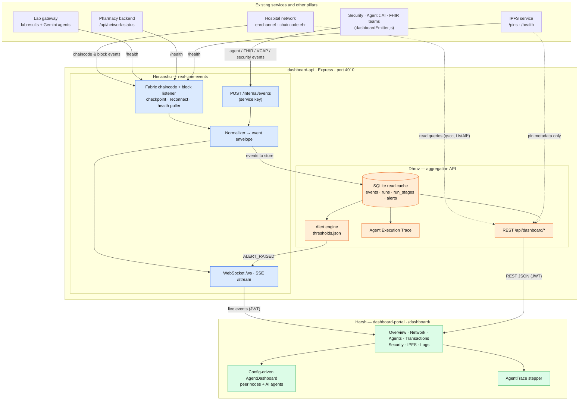
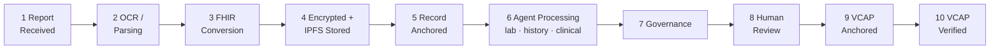
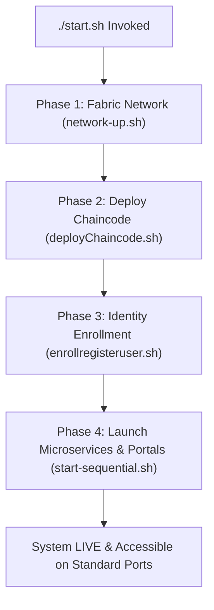

# 🏥 Enterprise Blockchain Electronic Health Record (EHR) System

     

## 📌 Executive Summary

The **Blockchain Electronic Health Record (EHR) System** is a decentralized, enterprise-grade healthcare federation built on Hyperledger Fabric v2.5. By uniting independent stakeholders (Hospital, Pharmacy, Lab, and Digilocker) on a shared immutable ledger, it solves critical challenges in data fragmentation, single points of failure, and unauthorized access. The architecture strictly enforces Attribute-Based Access Control (ABAC) and cryptographically guaranteed patient sovereignty, ensuring medical records are only accessible with explicit, on-chain consent.

---

## 🧬 Complete System Architecture

The network connects **5 Fabric Peers** across 3 autonomous organizations (`HospitalMSP`, `DiagnosticsMSP`, `ProviderMSP`), orchestrated by a Raft consensus Orderer, 4 Certificate Authorities, 6 Microservice Gateways, and 2 active Web Frontends:

```mermaid
flowchart TB
    subgraph Clients["1. Client Frontends Tier"]
        HP["🏥 Hospital Web Portal<br/>(Port :5173 - React/Vite)<br/>Staff: Reception, Doctor, Nurse, Pharmacy, Admin"]
        PP["👤 Patient Web Portal<br/>(Port :5174 - React/Vite)<br/>Self-Service: Consent, Timeline, Master EHR"]
        PHARM_FE["💊 Pharmacy Portal<br/>(Port :5175 - React/Vite)<br/>Inventory & Direct Dispensing"]
        LAB_FE["🧪 Lab Control Deck<br/>(Port :8080 - HTML5/JS)<br/>Lab Reports & AI Diagnostics"]
    end

    subgraph Gateways["2. Microservice & REST Gateway Tier"]
        P0_API["peer0-api (:4001)<br/>Receptionist & Admin Gateway"]
        P1_API["peer1-api (:4002)<br/>Doctor & MedRecords Gateway"]
        P2_API["peer2-api (:4003)<br/>Nurse & Pharmacist Gateway"]
        EXT_API["extorg-api (:4004)<br/>Diagnostics & Provider Gateway"]
        PAT_API["patient-api (:4005)<br/>Patient Vault & Consent Gateway"]
        IPFS_SVC["ipfs-service (:4006)<br/>Off-chain Storage Bridge"]
    end

    subgraph FabricNetwork["3. Hyperledger Fabric Network Tier (channel: ehrchannel)"]
        subgraph HospMSP["Hospital Organization (HospitalMSP)"]
            PEER0["📋 Reception & Admin Peer<br/>(peer0.hospital.example.com:7051)<br/>Intake, Registration & Admin"]
            PEER1["🏥 Doctor Peer<br/>(peer1.hospital.example.com:9051)<br/>Diagnoses, Prescriptions & Record Sealing"]
            PEER2["🩺 Nurse & Pharmacy Peer<br/>(peer2.hospital.example.com:10051)<br/>Vitals Recording & Medication Dispensing"]
        end

        subgraph DiagMSP["Diagnostics Organization (DiagnosticsMSP)"]
            PEER_DIAG["🧪 Lab & Diagnostics Peer<br/>(peer0.diagnostic.example.com:8051)<br/>Lab Tests, Reports & AI Analysis"]
        end

        subgraph ProvMSP["Provider Organization (ProviderMSP)"]
            PEER_PROV["💳 Insurance & Billing Peer<br/>(peer0.provider.example.com:11051)<br/>Claims Auditing & Billing Settlement"]
        end

        subgraph OrdererGroup["Consensus Cluster (OrdererMSP)"]
            ORDERER["orderer.example.com<br/>Port: 7050 | Admin: 7053<br/>Raft Consensus Leader"]
        end

        subgraph CAGroup["Fabric Certificate Authorities"]
            CA_HOSP["ca-hospital (:7055)"]
            CA_DIAG["ca-diagnostics (:7056)"]
            CA_PROV["ca-provider (:7057)"]
            CA_ORD["ca-orderer (:7054)"]
        end
    end

    subgraph ExecutionStorage["4. Smart Contract & Storage Tier"]
        subgraph ChaincodeContainers["Chaincode Containers (Node.js)"]
            CC0["dev-peer0.hospital (ehr:1.0)"]
            CC1["dev-peer1.hospital (ehr:1.0)"]
            CC2["dev-peer2.hospital (ehr:1.0)"]
            CC_DIAG["dev-peer0.diagnostic (ehr:1.0)"]
            CC_PROV["dev-peer0.provider (ehr:1.0)"]
        end

        subgraph StorageLayer["Decentralized Storage"]
            IPFS_NODE["IPFS Kubo Node<br/>(ipfs.ehr.local :5001 / :8090)<br/>Encrypted Payloads & Lab PDFs"]
        end
    end

    %% Client to Gateway Routing
    HP -->|Receptionist / Admin| P0_API
    HP -->|Doctor Consults| P1_API
    HP -->|Vitals / Dispensing| P2_API
    PP -->|Consent / EHR / Visits| PAT_API
    PHARM_FE -->|Prescription Fulfill| P2_API
    LAB_FE -->|Lab Tests & Claims| EXT_API
    
    %% Storage & Gateways
    P1_API -.->|Pin Medical Summary| IPFS_SVC
    EXT_API -.->|Pin Lab PDF / Reports| IPFS_SVC
    IPFS_SVC -->|Store & Fetch CIDs| IPFS_NODE

    %% Gateway to Fabric Peers
    P0_API -->|gRPC TLS| PEER0
    P1_API -->|gRPC TLS| PEER1
    P2_API -->|gRPC TLS| PEER2
    EXT_API -->|gRPC TLS| PEER_DIAG
    EXT_API -->|gRPC TLS| PEER_PROV
    PAT_API -->|gRPC TLS| PEER0
    PAT_API -->|gRPC TLS| PEER1

    %% Peers to Orderer & Chaincode
    PEER0 <--> CC0
    PEER1 <--> CC1
    PEER2 <--> CC2
    PEER_DIAG <--> CC_DIAG
    PEER_PROV <--> CC_PROV

    PEER0 -->|Broadcast Tx| ORDERER
    PEER1 -->|Broadcast Tx| ORDERER
    PEER2 -->|Broadcast Tx| ORDERER
    PEER_DIAG -->|Broadcast Tx| ORDERER
    PEER_PROV -->|Broadcast Tx| ORDERER
```



---

## 📦 Folder Structure

```text
EHR_blockchain/
├── orgs/
│   ├── hospital/         # 🏥 Hospital Organization (Backend, UIs, Fabric Network)
│   ├── pharmacy/         # 💊 Pharmacy Organization (Swarm Network, UIs, APIs)
│   ├── lab/              # 🧪 Lab Organization (Analysis, OCR, IPFS Gateway)
│   └── digilocker/       # 🔐 Digilocker System (Patient Data Vault)
│       # 📊 Group 1 Dashboard (planned): hospital/.../ehr-backend-v3/dashboard-api + ehr-frontend-v2/dashboard-portal
├── start.sh              # 🚀 Unified startup orchestrator (Fabric network + APIs + Portals)
├── stop.sh               # 🛑 Stop all running services & blockchain network
├── setup.sh              # 📦 Automated dependency installation
├── start-sequential.sh   # Background microservice starter and manager
└── start-sequential.ps1  # Native Windows alternative startup script
```

---

## ⚙️ Updated Implementation Details

We have recently upgraded the core infrastructure to support robust distributed environments and advanced AI workloads:

* **Unified Startup Orchestration (`start.sh`)**: A universal initialization script that dynamically resolves paths, injects environment variables, boots the Hyperledger Fabric nodes, verifies chaincode deployment, and brings up all 4 web frontends and microservices.
* **4 Distinct Agentic Peer Roles**: Granular ABAC enforcement is now mapped to specific peers: **Doctor** (diagnostics/prescriptions), **Nurse** (vital signs), **Pharmacy** (inventory/dispensing), and **Lab** (test execution and AI-assisted result uploads).
* **Asynchronous IPFS & OCR Processing**: The `POST /api/records/ipfs` routes have been refactored. Heavy PDF OCR extraction (Tesseract.js) and IPFS pinning are now executed in background threads, returning `202 Accepted` immediately to prevent frontend HTTP timeouts on large medical files.
* **Dynamic Environment Variables in Docker Swarm**: Swarm cluster networking is fully dynamic. Files like `hosts.final` rely on environment variable substitution (`${MACHINE1_IP}`, etc.) instead of hardcoded IPs, allowing seamless deployment across dynamic distributed servers.
* **Roadmap: VCAP and FHIR R4 Interoperability**: Upcoming milestones include native FHIR R4 standard conversions for all on-chain payloads and Verifiable Clinical AI Provenance (VCAP) to cryptographically trace and audit Gemini AI-generated diagnostic recommendations.

---

## 📊 Group 1 — Observability Dashboard (Proposed Architecture)

> **Status:** Proposed · Phase 1 (Dashboard Foundation) ≈ 35% complete
> **Pillar:** Dashboard / Observability (1 of 4 — alongside Security, Agentic AI and Standard EHR / FHIR)

Group 1 builds a **read-only observability dashboard** for the whole platform: live Fabric network health, ledger transactions, AI agent executions, IPFS activity and security events in one React app, served at `http://localhost/dashboard/`. It replaces manual page refreshes with **real-time push updates** driven by Fabric chaincode and block events.

### 👥 Team & Tracks

| Member | Track | Novelty |
| :--- | :--- | :--- |
| **Himanshu** | Real-Time Event Architecture & Core Orchestration | WebSocket/SSE gateway fed by a checkpointed Fabric chaincode-event and block listener — no UI polling |
| **Harsh Bhagat** | Frontend Shell & Agentic Peer Dashboards | One configuration-driven `AgentDashboard` that renders every peer node and AI agent with zero duplicated pages |
| **Dhruv Kumarawat** | Backend Aggregation API & Agent Execution Trace | A stage-by-stage Agent Trace stitched from FHIR, AI, IPFS, Fabric and VCAP events for each clinical AI run |

### 🧭 Architecture Diagram



**Flow:** Fabric events and pushed events from other teams → normalizer → live WebSocket stream **and** SQLite read cache → REST API, Agent Trace and alerts → React dashboard. The dashboard never writes to the ledger.

### 🔁 Agent Execution Trace (10 stages, agreed across pillars)



The record is anchored before AI runs (Security's async design), so stages 6–10 can arrive minutes or hours later. Stage statuses: `DONE`, `FAILED`, `SKIPPED`, `PENDING`, `WAITING_HUMAN`. All events for one run share `correlationId` = the AI orchestrator's `runId` = VCAP `executionId`.

### 📨 Common Event Envelope

Every team emits events in this shape (via `dashboardEmitter.js` → `POST /internal/events`, or as Fabric chaincode events):

```json
{
  "eventId": "evt-7f3a9c",
  "eventType": "AGENT_EXECUTION_COMPLETED",
  "timestamp": "2026-09-15T10:20:00Z",
  "source": "lab-agent",
  "org": "DiagnosticsMSP",
  "peerId": "peer0.lab.example.com",
  "severity": "INFO",
  "txId": "a1b2c3...",
  "blockNumber": 1042,
  "correlationId": "RUN-001",
  "payload": { "patientIdHash": "hmac-sha256:...", "recordId": "LAB001", "durationMs": 1840 }
}
```

**Zero-PHI rule:** payloads carry only ids, `patientIdHash`, CIDs, hashes, statuses and timings — never raw patient ids, names, clinical values or AI summary text.

### 🔌 API & Routing

| Route | Owner | Purpose |
| :--- | :--- | :--- |
| `GET /api/dashboard/overview` | Dhruv | KPI cards: block heights, tx/min, peers online, active alerts |
| `GET /api/dashboard/network` | Dhruv | Peers, orderers, CAs, channels, status |
| `GET /api/dashboard/transactions` | Dhruv | Recent ledger writes |
| `GET /api/dashboard/agents` · `/agents/:agentId/executions` | Dhruv | Per-agent metrics and runs |
| `GET /api/dashboard/executions/:runId/trace` | Dhruv | Stage-by-stage Agent Trace |
| `GET /api/dashboard/ipfs` · `/security/events` · `/alerts` | Dhruv | IPFS metadata, audit & security events, alerts |
| `ws://localhost/api/dashboard/ws` · `GET /api/dashboard/stream` | Himanshu | Live event stream (WebSocket / SSE) |
| `POST /internal/events` (not exposed via Nginx) | Himanshu | Ingest endpoint for other teams' events |

| Service | Container | Port | Public URL |
| :--- | :--- | :--- | :--- |
| dashboard-api | `h-dashboard-api` | 4010 | `/api/dashboard/` |
| dashboard-portal | `h-dashboard-portal` | 5176 | `/dashboard/` |

### 📁 Group 1 Folder Structure (planned)

```text
orgs/hospital/EHR_hospitalOrg-main/
├── ehr-backend-v3/dashboard-api/
│   └── src/
│       ├── contracts/     # Event envelope, event registry, response shapes
│       ├── collector/     # Himanshu — Fabric listener, health poller
│       ├── normalizer/    # Himanshu — raw events → envelope
│       ├── realtime/      # Himanshu — WebSocket / SSE gateway
│       ├── routes/        # Dhruv — REST endpoints
│       ├── services/      # Dhruv — network, agents, IPFS, security aggregation
│       ├── store/         # Dhruv — SQLite read cache
│       └── alerts/        # Dhruv — alert engine + thresholds.json
└── ehr-frontend-v2/dashboard-portal/
    └── src/
        ├── pages/         # Harsh — Overview, Network, Agents, Transactions, Security, IPFS, Logs
        ├── components/    # Harsh — MetricCard, StatusBadge, AgentCard, AgentDashboard, AgentTrace
        ├── config/        # Harsh — agentConfig.js (peer + AI agents)
        ├── services/      # API client
        └── hooks/         # useDashboardSocket
```

### 🤝 Integration with the Other Pillars

* **Security:** dashboard-api and the WebSocket use Security's JWT and role claims; consent, record-access, break-glass, VCAP and audit events are displayed, not re-implemented.
* **Agentic AI:** the orchestrator and agents (lab, history, clinical, governance) emit run and step events; the dashboard shows them and the human-review status.
* **Standard EHR / FHIR:** `FHIR_CONVERSION_STARTED / COMPLETED / FAILED` events fill stage 3 of the trace.
* **Chaincode:** one shared `emitEvent(ctx, name, payload)` helper, one event per transaction (Fabric keeps only the last `setEvent`), deployed in a single coordinated upgrade.

---

## 📋 System Prerequisites & Compatibility

Before running the system, ensure your machine meets the following environment and hardware prerequisites:

### 1. Supported Operating Systems
| Operating System | Support Level | Requirements & Setup Notes |
| :--- | :--- | :--- |
| **Ubuntu Linux** (22.04 / 24.04 / 26.04 LTS) | 🌟 **Recommended (Native)** | Best performance. Native support for Docker daemon and Fabric ELF binaries. |
| **Windows 10 / 11** | 🌟 **Supported via WSL2** | **Must run inside WSL2 (Ubuntu 22.04+)**. Do **not** run via Windows CMD or PowerShell (Fabric requires Linux container volume mounts and ELF binaries). |
| **macOS** (Intel / Apple Silicon) | ⚡ Supported via Docker | Ensure Docker Desktop is installed with Rosetta 2 / x86_64 emulation enabled. |

### 2. Hardware Recommendations
* **RAM:** 8 GB minimum (16 GB recommended to run all 5 peers, orderer, IPFS, and 8 microservices smoothly).
* **Storage:** 20 GB free disk space (for Docker images, chaincode containers, and IPFS cache).
* **CPU:** 4 cores minimum.

### 3. Required Tools & One-Liner Install
Run this one command on your Ubuntu terminal (native or inside WSL2) to install all necessary packages:

```bash
# 1. Install Docker, Docker Compose Plugin, Node.js (v20+), npm, curl, and jq
sudo apt-get update && sudo apt-get install -y docker.io docker-compose-v2 nodejs npm curl jq

# 2. Add current user to Docker group & grant socket permissions
sudo usermod -aG docker $USER
sudo chmod 666 /var/run/docker.sock
```

> [!NOTE]
> If you just added yourself to the `docker` group, either log out and log back in, or run `newgrp docker` so your terminal applies the group membership without needing `sudo`.

---

## 🚀 Quickstart Guide & Setup Instructions

### ⚡ Essential Shell Command Summary

Use these three core shell scripts to setup, run, and terminate the entire EHR Blockchain project:

| Action | Shell Command | What It Does |
| :--- | :--- | :--- |
| **1. Install Dependencies** *(First run only)* | `./setup.sh` | Pulls official Docker images & installs `npm` dependencies across all modules. |
| **2. Start the Project** | `./start.sh` | Initializes Fabric blockchain, deploys chaincode, and launches all 4 frontends & 6 backend APIs. |
| **3. Check Service Status** | `./start-sequential.sh status` | Displays process IDs (PIDs) and health status for all background microservices and portals. |
| **4. Stop the Project** | `./stop.sh` | Cleanly stops all Node.js background services, frontends, and Docker containers. |

---

### Step 1: Clone or Pull the Repository

```bash
git clone https://github.com/devbyhimans/Electronic_Health_Record_Blockchain.git
cd Electronic_Health_Record_Blockchain
git checkout fix-recover-and-run
```

---

### Step 2: Run One-Command Automated Setup (`./setup.sh`)
Run the setup script once to prepare the environment and install dependencies:

```bash
./setup.sh
```

### Step 2: Run One-Command Automated Setup (`./setup.sh`)
Run the setup script once to prepare the local environment and install all dependencies:

```bash
./setup.sh
```

#### 🔍 Under the Hood: What `./setup.sh` Executes
1. **Host Environment & Tooling Verification:**
   - Detects host architecture and checks that all required CLI utilities are present (`docker`, `docker compose`, `node` v20+, `npm`, `curl`, `jq`).
   - Verifies the Docker daemon is active and tests direct write access to `/var/run/docker.sock` without `sudo`.
2. **Docker Image Pre-Caching:**
   - Pre-pulls official Docker container images to prevent network timeout issues during the live start phase:
     - `hyperledger/fabric-peer:latest` — Fabric peer node binary environment.
     - `hyperledger/fabric-orderer:latest` — Raft consensus ordering service.
     - `hyperledger/fabric-ca:latest` — Certificate Authority daemon.
     - `hyperledger/fabric-ccenv:2.5` — Chaincode compilation builder environment.
     - `hyperledger/fabric-nodeenv:2.5` — Node.js chaincode runtime container.
     - `ipfs/kubo:latest` — Decentralized IPFS storage engine.
3. **Automated Cross-Module Dependency Installation (`npm install`):**
   - Automatically installs required Node.js packages across all 11 sub-projects in parallel:
     - `ehr-chaincode-v3` — Fabric Contract API & Shim libraries.
     - `ipfs-service` (`:4006`) — IPFS HTTP client, Express, CORS.
     - `peer0-api` (`:4001`) — Fabric Gateway SDK, JWT auth, Bcrypt, Express.
     - `peer1-api` (`:4002`) — Fabric Gateway SDK, Doctor clinical endpoints.
     - `peer2-api` (`:4003`) — Fabric Gateway SDK, Nurse & Pharmacy endpoints.
     - `extorg-api` (`:4004`) — Fabric Gateway SDK, Lab & Insurance endpoints.
     - `patient-api` (`:4005`) — Fabric Gateway SDK, Patient vault & ABAC consent routes.
     - `hospital-portal` (`:5173`) — Vite, React 18, Tailwind CSS, Lucide icons, Axios.
     - `patient-portal` (`:5174`) — Vite, React 18, Tailwind CSS, Framer Motion, Axios.
     - `pharmacy-frontend` (`:5175`) — Vite, React, Axios, Pharmacy inventory views.
     - `lab-node-gateway` (`:8080`) — Express, Fabric Gateway client, OCR & AI agent integration.

---

### Step 3: Start the Entire Blockchain & Application Stack (`./start.sh`)
Start the entire blockchain network, chaincode, and all applications with a single command:

```bash
./start.sh
```

#### 🔍 Under the Hood: What `./start.sh` Executes in Sequence



1. **Phase 1: Hyperledger Fabric Network Initialization (`network-up.sh`):**
   - **Docker Bridge:** Checks for the presence of the Docker network `ehr_network` and creates it if missing.
   - **Certificate Authorities:** Spins up 4 separate CAs:
     - `ca-hospital` (port `7054`): Issues certificates for Hospital staff & peers.
     - `ca-diagnostics` (port `8054`): Issues certificates for Lab & pathology staff.
     - `ca-provider` (port `9054`): Issues certificates for Insurance & claims officers.
     - `ca-orderer` (port `10054`): Issues TLS and signing certs for the Raft ordering cluster.
   - **Cryptographic Material Generation:** Generates all MSP directories, TLS certificates, and channel genesis block for `ehrchannel` using `configtxgen`.
   - **Orderer & Peer Node Boot:** Starts 1 Raft Orderer (`orderer.example.com:7050`) and 5 Fabric Peer nodes:
     - `peer0.hospital.example.com` (`:7051`) — Reception & Admin Peer
     - `peer1.hospital.example.com` (`:9051`) — Doctor Peer
     - `peer2.hospital.example.com` (`:10051`) — Nurse & Pharmacy Peer
     - `peer0.diagnostic.example.com` (`:8051`) — Lab & Diagnostics Peer
     - `peer0.provider.example.com` (`:11051`) — Insurance Claims Peer
   - **IPFS Kubo Node (`ipfs0`):** Launches the IPFS Kubo container, automatically disables subdomain redirection (`Gateway.PublicGateways.localhost.UseSubdomains = false`) to guarantee reliable CID path fetching, and exposes Web Gateway on `:8090` and WebUI on `:5001`.
   - **Channel Creation & Peer Joining:** Creates application channel `ehrchannel`, joins all 5 peers, and commits anchor peer configurations.

2. **Phase 2: Smart Contract (Chaincode) Lifecycle Deployment (`deployChaincode.sh`):**
   - **Packaging:** Packages the Node.js smart contract from `ehr-chaincode-v3` into `channel-artifacts/ehr_1.0.tar.gz`.
   - **Installation:** Installs the chaincode package on all 5 peers across `HospitalMSP`, `DiagnosticsMSP`, and `ProviderMSP`.
   - **Approval:** Queries the package ID and approves the definition on behalf of all 3 organizations using their respective admin credentials.
   - **Commit:** Commits the chaincode definition to `ehrchannel` with endorsement policies.
   - **Container Execution:** Fabric automatically starts 5 isolated Docker chaincode execution containers (`dev-peer*`) to handle transaction queries and state transitions.

3. **Phase 3: Operational Identity Enrollment (`enrollregisteruser.sh`):**
   - Interacts with the CAs to generate wallet cryptographic credentials for operational identities:
     - `hospitaladmin`, `receptionist`, `doctor`, `nurse`, `pharmacist`, `medrecordofficer`, `labreceptionist`, `labtechnician`, `labsupervisor`, `billingofficer`, `claimsauditor`, `insuranceofficer`.

4. **Phase 4: Launch Microservices & 4 Frontends (`start-sequential.sh start`):**
   - Sequentially starts the backend microservices with staggered health checks:
     - `ipfs-service` on port `4006` (Decentralized storage bridge)
     - `peer0-api` on port `4001` (Reception / Admin Gateway)
     - `peer1-api` on port `4002` (Doctor Clinical Gateway)
     - `peer2-api` on port `4003` (Nurse / Pharmacy Gateway)
     - `extorg-api` on port `4004` (Lab / Insurance Claims Gateway)
     - `patient-api` on port `4005` (Patient Self-Service Gateway)
   - Launches all 4 Web Frontends:
     - 🏥 **Hospital Web Portal** on `http://localhost:5173` (Vite dev server)
     - 👤 **Patient Web Portal** on `http://localhost:5174` (Vite dev server)
     - 💊 **Pharmacy MedBlock Portal** on `http://localhost:5175` (Vite dev server)
     - 🧪 **Lab Results Control Deck** on `http://localhost:8080` (Express & Web UI)
   - Writes all process IDs (PIDs) to `start-sequential.sh` memory for instant status queries.

---

### Step 4: Verify the Running System & Universal Port Cheat Sheet

All port numbers are standardized and will be **identical for everyone** running this repository. All services bind to `0.0.0.0` so they are accessible locally via `localhost` or over a local Wi-Fi/LAN via the host's IP address (e.g. `http://192.168.x.x:5173`).

| Component / Service | Port | Local URL | Role / Purpose |
| :--- | :--- | :--- | :--- |
| **🏥 Hospital Web Portal** | `5173` | [http://localhost:5173](http://localhost:5173) | Doctor, Receptionist, Nurse, Admin clinical portal |
| **👤 Patient Web Portal** | `5174` | [http://localhost:5174](http://localhost:5174) | Patient self-service, timeline & consent manager |
| **💊 Pharmacy MedBlock Portal** | `5175` | [http://localhost:5175](http://localhost:5175) | Medication inventory & dispense queue |
| **🧪 Lab Results Control Deck** | `8080` | [http://localhost:8080](http://localhost:8080) | Pathology reports, AI diagnostics & on-chain verification |
| **📦 IPFS CID Web Gateway** | `8090` | [http://localhost:8090/ipfs/](http://localhost:8090/ipfs/) | Direct browser CID payload viewer |
| **🌐 IPFS Node WebUI Dashboard** | `5001` | [http://localhost:5001/webui](http://localhost:5001/webui) | Visual IPFS node management console |
| **📋 Reception & Admin API** | `4001` | [http://localhost:4001/health](http://localhost:4001/health) | Gateway for `peer0.hospital:7051` |
| **🩺 Doctor API** | `4002` | [http://localhost:4002/health](http://localhost:4002/health) | Gateway for `peer1.hospital:9051` |
| **💊 Nurse & Pharmacy API** | `4003` | [http://localhost:4003/health](http://localhost:4003/health) | Gateway for `peer2.hospital:10051` |
| **🔬 Lab & Claims API** | `4004` | [http://localhost:4004/health](http://localhost:4004/health) | Gateway for `peer0.diagnostic` & `peer0.provider` |
| **👤 Patient Vault API** | `4005` | [http://localhost:4005/health](http://localhost:4005/health) | Gateway for patient self-service |
| **🌉 IPFS Microservice Bridge** | `4006` | [http://localhost:4006/health](http://localhost:4006/health) | REST file pinning bridge |

You can check the live status of all background services at any time:
```bash
./start-sequential.sh status
```

---

### Step 5: Stop the Stack Cleanly (`./stop.sh`)
When you are done with your session, tear down all services and containers cleanly with one command:

```bash
./stop.sh
```

#### 🔍 Under the Hood: What `./stop.sh` Executes in Sequence
1. **Application Layer Teardown:**
   - Gracefully stops all 10 background Node.js processes, REST API microservices, and Vite dev servers (`:4001`-`:4006`, `:5173`, `:5174`, `:5175`, `:8080`).
   - Releases all listening TCP ports and clears background PID references.
2. **Docker Container Teardown:**
   - Stops and removes all 5 Fabric Peer containers and Orderer container.
   - Stops and removes the IPFS Kubo container.
   - Stops and removes the 4 Certificate Authority containers.
   - Removes the Docker bridge network `ehr_network`.
3. **Chaincode Cleanup:**
   - Removes all running `dev-peer*` chaincode execution containers.
   - Untags and removes temporary chaincode Docker image layers.
4. **Volume & State Hygiene:**
   - Removes ephemeral container volumes and socket locks while keeping the codebase and git state clean.
   - The repository is immediately ready for a clean restart with `./start.sh`.

---

### Step 6: Terminal Ledger Explorer & Audit Tool (`./ehr_explorer.sh`)
To inspect blocks, transactions, and live world state directly in your terminal:

```bash
# Location: orgs/hospital/EHR_hospitalOrg-main/ehr-network/ehr_explorer.sh
cd orgs/hospital/EHR_hospitalOrg-main/ehr-network
bash ehr_explorer.sh          # Auto-sync new blocks and print full audit log
bash ehr_explorer.sh --state  # Print current world state (Patients, Visits, EHR, Access)
bash ehr_explorer.sh --blocks # Show block headers, transaction IDs, creators, and read/writes
bash ehr_explorer.sh --dump   # Save complete terminal dump to a timestamped file in ledger_dump/
```

---

### 🛠️ Independent Service Management
To manage or inspect individual backend and frontend processes without restarting Docker:
```bash
./start-sequential.sh status   # Check status and PIDs of all 8 application services
./start-sequential.sh stop     # Stop only the web and API services
./start-sequential.sh start    # Start only the web and API services
./start-sequential.sh restart  # Restart only the web and API services
```

---

## 🌐 Frontends, Pages & Routing Breakdown

The system provides 2 live React/Vite frontends, plus 2 auxiliary modules, totaling **16 primary routed pages** and **5 auxiliary views**:

### 1. Hospital Web Portal (`http://localhost:5173`)
Role-based administrative and clinical dashboard for hospital staff members.

| Route | View Component | Allowed Roles | Description & Key Features |
| :--- | :--- | :--- | :--- |
| `/login` | `Login.jsx` | Public | Staff credential authentication & role-based token issuance |
| `/patients` | `Patients.jsx` | `receptionist`, `admin` | Search master patient directory, view demographic cards |
| `/register` | `Patients.jsx` | `receptionist`, `admin` | Register new patient on-chain (`CreatePatientRecord`) |
| `/visits` & `/visits/:id` | `Visits.jsx` | `receptionist`, `admin` | Real-time tracker for open, in-consultation, and discharged visits |
| `/open-visit` | `OpenVisit.jsx` | `receptionist`, `admin` | Intake form to open an active visit and assign attending doctor |
| `/my-visits` | `DoctorVisits.jsx` / `NurseVisits.jsx` | `doctor`, `nurse` | **Doctor:** Diagnose, prescribe medications.<br/>**Nurse:** Record vital signs (BP, pulse, temp, SpO2). |
| `/dispense` | `PharmacistPage` | `pharmacist` | Medication dispensing queue and pharmacy fulfillment |
| `/finalize` | `MedRecordsPage` | `medrecordofficer` | Seal finalized visit record and anchor summary to IPFS |
| `/staff` | `Staff.jsx` | `admin` | Staff user account management and role provisioning |

### 2. Patient Web Portal (`http://localhost:5174`)
Self-sovereign patient portal enabling decentralized identity login and consent control.

| Route | View Component | Key Features & Ledger Interactions |
| :--- | :--- | :--- |
| `/login` | `Login.jsx` | Direct login with registered Patient ID (e.g., `PAT-DEMO-001`) |
| `/overview` | `Overview.jsx` | Health dashboard with active conditions, vitals history, and recent visits |
| `/visits` | `VisitsListPage` | Comprehensive chronological record of all past and active consultations |
| `/visits/:id` | `VisitDetailPage` | Detailed clinical timeline, prescriptions, vital charts, and IPFS CIDs |
| `/ehr` | `EHRPage` | Master Health Record: allergies, persistent medical conditions, blood group |
| `/access` | `AccessPage` | **Granular ABAC Consent Manager:** Grant or revoke record access to doctors/orgs |
| `/signatures` | `SignaturesPage` | Cryptographic signature verifier ensuring doctors' and pharmacists' integrity |
| `/profile` | `Profile.jsx` | Demographics, emergency contact details, and public verification keys |

### 3. Auxiliary Frontends
* **Pharmacy Portal** (`http://localhost:5175`): `Dashboard` (inventory & dispense tracker) and `CreateRecord` (custom prescription entry).
* **Lab Results Control Deck** (`http://localhost:8080`): Single-page control deck with 3 live panels (Create Record & PDF Report Upload, Ledger Explorer, AI Decision Support).

---

## 🔑 Entry Points & Default Credentials

All pre-configured staff accounts use default password: `password123`

| Username | Password | Role | Landing URL | Target Gateway | Target Peer |
| :--- | :--- | :--- | :--- | :--- | :--- |
| `receptionist` | `password123` | Receptionist | [http://localhost:5173/patients](http://localhost:5173/patients) | `peer0-api` (:4001) | `peer0.hospital.example.com` (:7051) |
| `doctor` | `password123` | Doctor | [http://localhost:5173/my-visits](http://localhost:5173/my-visits) | `peer1-api` (:4002) | `peer1.hospital.example.com` (:9051) |
| `nurse` | `password123` | Nurse | [http://localhost:5173/my-visits](http://localhost:5173/my-visits) | `peer2-api` (:4003) | `peer2.hospital.example.com` (:10051) |
| `pharmacist` | `password123` | Pharmacist | [http://localhost:5173/dispense](http://localhost:5173/dispense) | `peer2-api` (:4003) | `peer2.hospital.example.com` (:10051) |
| `medrecordofficer` | `password123` | Medical Records | [http://localhost:5173/finalize](http://localhost:5173/finalize) | `peer1-api` (:4002) | `peer1.hospital.example.com` (:9051) |
| `hospitaladmin` | `password123` | Admin | [http://localhost:5173/patients](http://localhost:5173/patients) | `peer0-api` (:4001) | `peer0.hospital.example.com` (:7051) |
| `labtechnician` | `password123` | Lab Tech | [http://localhost:8080/](http://localhost:8080/) | `extorg-api` (:4004) | `peer0.diagnostic.example.com` (:8051) |
| `insuranceofficer` | `password123` | Insurance Auditor | [http://localhost:4004](http://localhost:4004) | `extorg-api` (:4004) | `peer0.provider.example.com` (:11051) |
| `PAT-DEMO-001` | *N/A (Patient ID)* | Patient | [http://localhost:5174/overview](http://localhost:5174/overview) | `patient-api` (:4005) | `peer0.hospital` / `peer1.hospital` |

---

## 🏛️ Fabric Peers & Network Topology

The blockchain consensus runs on channel `ehrchannel` across **5 Fabric Peers**, **1 Raft Orderer**, **4 CAs**, and **5 Chaincode Containers**.

### 🏷️ Intuitive Peer Role Mapping (Quick Reference)

To make the network easily understandable, each numbered Fabric peer is mapped to its functional healthcare role:

| Intuitive Role Name | Fabric Domain | Organization | Port | Connected Gateway | Primary Healthcare Responsibilities |
| :--- | :--- | :--- | :--- | :--- | :--- |
| **📋 Reception & Admin Peer** | `peer0.hospital.example.com` | `HospitalMSP` | `7051` | `peer0-api` (:4001) | Patient intake, identity registration, visit dispatch, hospital administration |
| **🏥 Doctor Peer** | `peer1.hospital.example.com` | `HospitalMSP` | `9051` | `peer1-api` (:4002) | Doctor consultations, clinical diagnoses, prescriptions, medical record finalization |
| **🩺 Nurse & Pharmacy Peer** | `peer2.hospital.example.com` | `HospitalMSP` | `10051` | `peer2-api` (:4003) | Vital signs capture, care notes, pharmacist medication dispensing |
| **🧪 Lab & Diagnostics Peer** | `peer0.diagnostic.example.com` | `DiagnosticsMSP` | `8051` | `extorg-api` (:4004) | Laboratory test execution, pathology & radiology report uploads, AI analysis |
| **💳 Insurance & Billing Peer** | `peer0.provider.example.com` | `ProviderMSP` | `11051` | `extorg-api` (:4004) | Medical insurance coverage verification, billing claims auditing & settlement |
| **⚖️ Consensus Orderer** | `orderer.example.com` | `OrdererMSP` | `7050` | Fabric Network | Raft consensus leader, block generation, ordering & broadcast validation |

### 🛠️ Container & Technical Specification

| Container Name | Domain Name | Organization (MSP) | Ports (Core / Gossip) | Assigned Roles & Responsibilities |
| :--- | :--- | :--- | :--- | :--- |
| `docker-peer0.hospital.example.com-1` | `peer0.hospital.example.com` | `HospitalMSP` | `7051` / `17051` | **Reception & Admin Peer:** Intake, registration, admin operations |
| `docker-peer1.hospital.example.com-1` | `peer1.hospital.example.com` | `HospitalMSP` | `9051` / `19051` | **Doctor Peer:** Clinical diagnoses, prescriptions, and records finalization |
| `docker-peer2.hospital.example.com-1` | `peer2.hospital.example.com` | `HospitalMSP` | `10051` / `20051` | **Nurse & Pharmacy Peer:** Vital signs recording and pharmacy dispensing |
| `docker-peer0.diagnostic.example.com-1` | `peer0.diagnostic.example.com` | `DiagnosticsMSP` | `8051` / `18051` | **Lab & Diagnostics Peer:** Test results, diagnostic reports, and radiology |
| `docker-peer0.provider.example.com-1` | `peer0.provider.example.com` | `ProviderMSP` | `11051` / `21051` | **Insurance & Billing Peer:** Claim verification, billing, and coverage audit |
| `docker-orderer.example.com-1` | `orderer.example.com` | `OrdererMSP` | `7050` / `7053` | **Consensus Orderer:** Raft leader, block generation, and ordering |

### Certificate Authorities & Supporting Nodes
* **`ca-hospital`** (`:7055`): Enrolls staff and identities for `HospitalMSP`.
* **`ca-diagnostics`** (`:7056`): Enrolls identities for `DiagnosticsMSP`.
* **`ca-provider`** (`:7057`): Enrolls identities for `ProviderMSP`.
* **`ca-orderer`** (`:7054`): Enrolls orderer cluster certificates.
* **`ipfs.ehr.local`**:
  * **IPFS Web Gateway** (`:8090`): Direct browser CID inspection (e.g. `http://localhost:8090/ipfs/<CID>`).
  * **IPFS Node WebUI Dashboard** (`:5001`): Interactive visual dashboard at `http://localhost:5001/webui`.
  * **Kubo RPC API** (`:5001`): Programmatic RPC API (requires HTTP `POST`, e.g. `curl -X POST http://localhost:5001/api/v0/id`).
* **Chaincode Containers (`dev-peer*`)**: Node.js chaincode `ehr` (v1.0, sequence 1) running on every peer.

---

## 🔌 Microservice & REST API Gateways

| Service | Port | Endpoint URL | Gateway Target | Responsibilities |
| :--- | :--- | :--- | :--- | :--- |
| **`peer0-api`** | 4001 | `http://localhost:4001` | `peer0.hospital:7051` | Patient registration, visit dispatch, staff management |
| **`peer1-api`** | 4002 | `http://localhost:4002` | `peer1.hospital:9051` | Doctor diagnoses, prescription issuance, record sealing |
| **`peer2-api`** | 4003 | `http://localhost:4003` | `peer2.hospital:10051` | Nurse vitals recording, pharmacist medication dispensing |
| **`extorg-api`** | 4004 | `http://localhost:4004` | `peer0.diagnostic:8051` & `peer0.provider:11051` | Lab test uploads, diagnostic reports, insurance auditing |
| **`patient-api`** | 4005 | `http://localhost:4005` | `peer0.hospital:7051` | Patient data vault, self-service queries, ABAC consent grant/revoke |
| **`ipfs-service`** | 4006 | `http://localhost:4006` | `ipfs.ehr.local:5001` | Async file pinning, CID resolution, and payload verification |

---

## 🔍 Troubleshooting

- **Docker Permission Denied:** Run `sudo chmod 666 /var/run/docker.sock` to ensure the background daemon has socket access.
- **Port Conflict (e.g. 7051 / 4001 already in use):** Run `./stop.sh` or check with `sudo lsof -i :<PORT>`.
- **View Logs:** Individual service logs are written directly to `logs/<service-name>.log`. Fabric container logs can be inspected via `docker logs <container-name>`.

