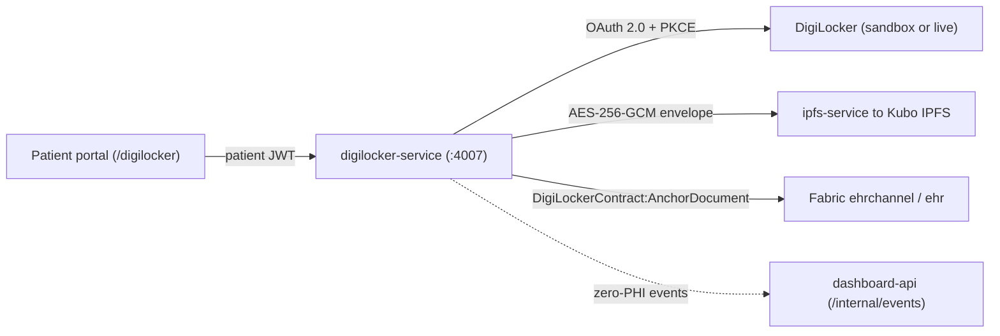

# DigiLocker vault

Lets a patient bring documents issued to their DigiLocker (lab reports, prescriptions, discharge summaries) into their health record. The document is encrypted before it is stored, the ciphertext goes to IPFS, and only hashes and the CID are anchored on Hyperledger Fabric.



## Parts

| Part | Location |
| --- | --- |
| Service (Express) | `orgs/digilocker/backend` |
| Chaincode contract | `orgs/hospital/EHR_hospitalOrg-main/ehr-chaincode-v3/lib/digilockerContract.js` |
| Patient UI | `orgs/hospital/EHR_hospitalOrg-main/ehr-frontend-v2/patient-portal/src/pages/DigiLocker.jsx` |
| Gateway route | `nginx/nginx.conf` → `/api/digilocker/` |

## Modes

- **sandbox** (default): a built-in simulator stands in for DigiLocker. Its consent page says it is a simulator, and the five documents it serves are generated PDFs marked "SANDBOX SAMPLE". Encryption, IPFS storage and ledger anchoring are the real code paths.
- **live**: the real DigiLocker OAuth 2.0 + PKCE flow. Needs `DIGILOCKER_CLIENT_ID` and `DIGILOCKER_CLIENT_SECRET` issued to a registered DigiLocker partner, and `<DIGILOCKER_PUBLIC_URL>/link/callback` registered as the redirect URI. This path has not been exercised against DigiLocker; the endpoints are configurable in `.env` because DigiLocker versions them.

## Before first use

1. `node scripts/init-env.js` at the repository root (creates `.env` with `JWT_SECRET`, `IPFS_SERVICE_KEY`, `DIGILOCKER_VAULT_KEY`, `DASHBOARD_SERVICE_KEY`).
2. Upgrade the `ehr` chaincode so the new `DigiLockerContract` is on the channel. Use the next free sequence number:

   ```bash
   cd orgs/hospital/EHR_hospitalOrg-main/ehr-network
   bash scripts/deployChaincode.sh --channel ehrchannel --chaincode-name ehr \
     --chaincode-path ../ehr-chaincode-v3 --version 3.1 --sequence <current + 1>
   ```

   Until this is done the vault page reports that anchoring failed.
3. `./start.sh` starts `h-digilocker-service` with the other services.

## API

All routes except `/health`, `/link/callback` and `/sandbox/*` require the patient portal's bearer token.

| Method | Path | Purpose |
| --- | --- | --- |
| GET | `/health` | Service, IPFS and Fabric status |
| GET | `/status` | Is this patient's locker linked |
| POST | `/link/start` | Returns the consent URL to open |
| GET | `/link/callback` | OAuth redirect target; returns to the portal |
| DELETE | `/link` | Unlink |
| GET | `/documents` | Documents issued to the linked locker, with anchored state |
| POST | `/documents/pull` | Pull → encrypt → IPFS → anchor one document |
| GET | `/vault` | Anchored documents (from the ledger) |
| GET | `/vault/:docId/verify` | Re-hash the stored copy and compare with the ledger |
| GET | `/vault/:docId/download` | Decrypt and download |
| GET | `/vault/:docId/history` | Ledger history of the anchor |
| DELETE | `/vault/:docId` | Withdraw (marks REVOKED on-chain, unpins from IPFS) |

## Security model

- Each document has its own key: HKDF-SHA256 over `DIGILOCKER_VAULT_KEY` with a random per-document salt, bound to the patient and document id as authenticated data. Ciphertext on IPFS is useless without the vault key.
- **The vault key is held by the service, not by the patient.** Whoever operates the service can decrypt. Losing the key makes every stored document unrecoverable; rotating it is not implemented.
- On-chain: document type, issuer id, SHA-256 of the plaintext and of the ciphertext, CID, a hash of the DigiLocker URI, timestamps. No names, no document content.
- OAuth tokens are sealed at rest; name, date of birth and gender returned by DigiLocker are discarded.
- Reads on-chain are limited to the patient (via the `patientService` identity), admins, and doctors or nurses holding the patient's active EHR consent grant.
- Largest document: 3 MB (`DIGILOCKER_MAX_DOCUMENT_BYTES`).

## Tests

```bash
cd orgs/digilocker/backend && npm install && npm test            # service: 10 tests, Fabric and IPFS faked
cd orgs/hospital/EHR_hospitalOrg-main/ehr-chaincode-v3 && node --test test/digilockerContract.test.js   # contract: 3 tests, in-memory stub
```
