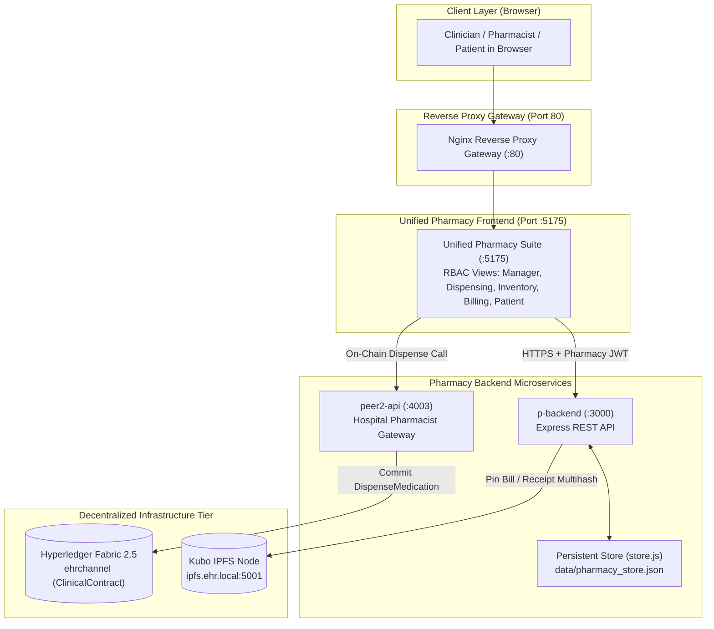

# Pharmacy Organization & Applications
## Decentralized Prescription Fulfillment, Persistent Store & Unified Pharmacy Suite

> **Module Lead / System Integration:** Himanshu (`devbyhimans`, 24MCF1R16) — Lead System Orchestrator  
> **Key Contributions:** Root-cause 500 error fix on `/api/inventory`, implementation of resilient persistent storage (`store.js`), automatic inventory stock deduction, Kubo IPFS multihash integration, Docker network bridging, and consolidation of all 5 legacy pharmacy portals into the **Unified Pharmacy Suite (`:5175`)**.

---

## 🏥 Overview

The Pharmacy Organization provides decentralized prescription fulfillment, inventory stock management, itemized outpatient billing, and patient consent governance for the EHR Blockchain Consortium.

All pharmacy workflows are integrated into the master Compose stack and accessible either directly on host ports or through the unified Nginx gateway on Port 80 (`/pharmacy/*`).

---

## 🚀 Application Map

| Application | Host Port | Gateway Route | Status | Technology Stack | Description |
|:---|:---:|:---|:---:|:---|:---|
| **Unified Pharmacy Suite** | `5175` | `/pharmacy/` | **ACTIVE** | React 18, Vite, Tailwind CSS | Unified 5-in-1 workspace: Manager, Pharmacist Dispensing, Stock Inventory, Outpatient Billing, and Patient Self-Service with Zero-Trust RBAC. |
| **Pharmacy Backend API** | `3000` | `/api/pharmacy/` | **ACTIVE** | Node.js Express, Persistent Store | Core pharmacy REST API connected to persistent store (`store.js`), Kubo IPFS (`:5001`), and Fabric `ehrchannel` via `peer2-api:4003`. |
| **Hospital Peer2 Gateway** | `4003` | `/api/hospital/peer2/` | **ACTIVE** | Node.js Express, Fabric Gateway | On-chain dispensing submission endpoint (`ClinicalContract:dispenseMedication`). |

> [!NOTE]
> **Consolidation Note:** The 5 legacy separate frontend dev servers (`:3001` Manager, `:3002` Employee, `:3003` Inventory, `:3004` Patient, `:3005` Billing) have been consolidated into the single **Unified Pharmacy Suite on Port `5175`** (`ehr_blockchain-p-frontend-1`) to dramatically reduce memory footprint while enforcing unified Zero-Trust authentication and session state.

---

## 🏛️ Architecture & Data Flow

---

## 🔑 Pharmacy User Roles & Credentials

| Username | Password | Role | Permitted Actions |
|:---|:---|:---|:---|
| `pharmacist` | `pharmpw` | Pharmacist | Query pending hospital prescriptions on-chain, verify medication, dispense medication (`ClinicalContract`) |
| `inventory_mgr_01` | `invpw` | Inventory Manager | View stock catalog, add new medicines, replenish inventory, adjust unit prices |
| `billing_clerk_01` | `billpw` | Billing Clerk | Create outpatient bills, select package templates (Post-Op, Chronic Care), trigger auto-inventory deduction, pin bills to IPFS |
| `pharmacy_mgr` | `adminpw` | Pharmacy Manager | Manage pharmacy personnel, audit financial billing ledger, review stock alerts |

---

## 📦 Persistent Storage & Automatic Stock Deduction

### 1. Persistent Storage (`data/pharmacy_store.json`)
Eliminates ephemeral in-memory state loss across container restarts. Managed atomically by `store.js`:
- `inventory`: Catalog of medicines, batch numbers, remaining quantities, unit costs, and expiration dates.
- `bills`: Itemized financial invoices with patient references, line items, timestamps, and IPFS multihash CIDs.
- `staff`: Registered pharmacy employees and credential hashes.

### 2. Automatic Inventory Stock Deduction Flow
When an itemized invoice is submitted via `POST /api/pharmacy/bills`:
1. Backend validates that all requested medicine quantities are currently available in `pharmacy_store.json`.
2. Subtracts the exact dispensed units from inventory atomically.
3. Generates a cryptographic SHA-256 invoice receipt and pins the JSON payload to Kubo IPFS (`:5001`).
4. Returns the confirmed transaction with the permanent IPFS CID multihash.

---

*Maintained by **Himanshu (24MCF1R16)** — Master of Computer Applications, NIT Warangal.*  
*Repository: [https://github.com/devbyhimans/Electronic_Health_Record_Blockchain.git](https://github.com/devbyhimans/Electronic_Health_Record_Blockchain.git)*
